# DevSecOps Pipeline: Secure CI/CD for a Spring Boot Application

A complete Jenkins pipeline that builds, tests, secures, deploys and monitors a Spring Boot application on Kubernetes, with security checks integrated at every phase, from pre-commit to operations (**Shift-Left / Shift-Right**).

> Academic project, ESPRIT (2026). The application itself (a timesheet / user-management REST API) is a simple Spring Boot app; the focus of this project is the **pipeline and the security controls around it**.

---

## Pipeline overview

```mermaid
flowchart LR
    A[Git checkout] --> B[Compile & JUnit/Mockito tests]
    B --> C[Talisman<br/>secret detection]
    C --> D[OWASP Dependency-Check<br/>SCA]
    D --> E[SonarQube<br/>SAST]
    E --> F[Package]
    F --> G[Gauntlt + nmap<br/>security acceptance]
    G --> H[Nexus<br/>artifact]
    H --> I[Docker build & push]
    I --> J[Kubernetes deploy<br/>& verify]
    J --> K[OWASP ZAP baseline<br/>DAST]
    K --> L[Prometheus / Grafana<br/>monitoring]
    L --> M[OpenSCAP<br/>continuous scanning]
```



## Security controls by phase

| Phase | Tool | What it checks |
|---|---|---|
| **Pre-commit** | Talisman | Blocks commits containing secrets (keys, tokens, passwords). The pipeline injects a fake AWS key to prove the hook catches it. |
| **Commit** | OWASP Dependency-Check | Known CVEs in Maven dependencies; build marked unstable above **CVSS 7**. |
| **Commit** | SonarQube | Static analysis: bugs, code smells, security hotspots. |
| **Commit** | JUnit / Mockito | Unit tests on the service layer. |
| **Acceptance** | Gauntlt + nmap | Attack-style acceptance tests against the running app (open ports, exposed services). |
| **Production** | OWASP ZAP Baseline | Passive dynamic scan of the application deployed on Kubernetes. |
| **Operations** | Prometheus + Grafana | Continuous `up` monitoring of the machine and the application. |
| **Operations** | OpenSCAP (Ubuntu OVAL) | Continuous vulnerability scanning of the host OS. |

Every scan publishes an **HTML report** archived as a Jenkins artifact, and the team receives an **email notification** with the build status (success / unstable with security alerts / failure).

## Delivery chain

- **Build & artifacts**: Maven, artifacts deployed to **Nexus**
- **Containerization**: Docker image pushed to Docker Hub (`mariemothmani/timesheet`)
- **Deployment**: `kubectl set image` + `rollout status` on a Kubernetes cluster, followed by a verification stage (pods & services)

## Secrets handling

No secret is stored in the pipeline code. Every sensitive value goes through the **Jenkins credentials store**:

| Secret | Jenkins credential |
|---|---|
| SonarQube token | `sonar-token` |
| NVD API key | `nvd-api-key` |
| Docker registry | `docker-registry-creds` |
| Kubeconfig | `kubeconfig-k8s` (file credential) |
| GitHub access | `github-pat` |

Docker credentials are passed with `--password-stdin` and shell tracing is disabled around the login, so they never appear in build logs.

## Repository structure

```
├── Jenkinsfile          # The full DevSecOps pipeline
├── .talismanrc          # Talisman configuration
├── gauntlt/nmap.attack  # Security acceptance scenario
├── Dockerfile
├── docker-compose.yml   # Local stack (app + MySQL)
├── pom.xml              # Maven build, Dependency-Check, Actuator/Micrometer
└── src/                 # Spring Boot application + unit tests
```

## Tech stack

`Jenkins` `Maven` `Talisman` `OWASP Dependency-Check` `SonarQube` `Gauntlt` `nmap` `Nexus` `Docker` `Kubernetes` `OWASP ZAP` `Prometheus` `Grafana` `OpenSCAP` `Spring Boot` `JUnit` `Mockito`

---

**Author:** Mariem Othmani · [LinkedIn](https://www.linkedin.com/in/mariem-othmani) · [GitHub](https://github.com/mariemothmani)
